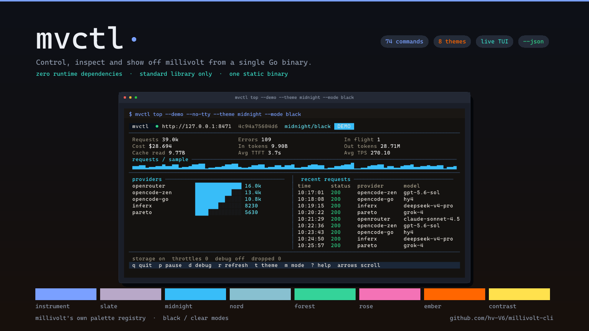
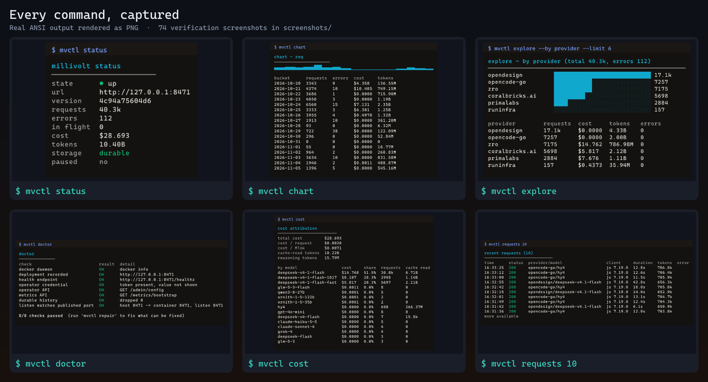
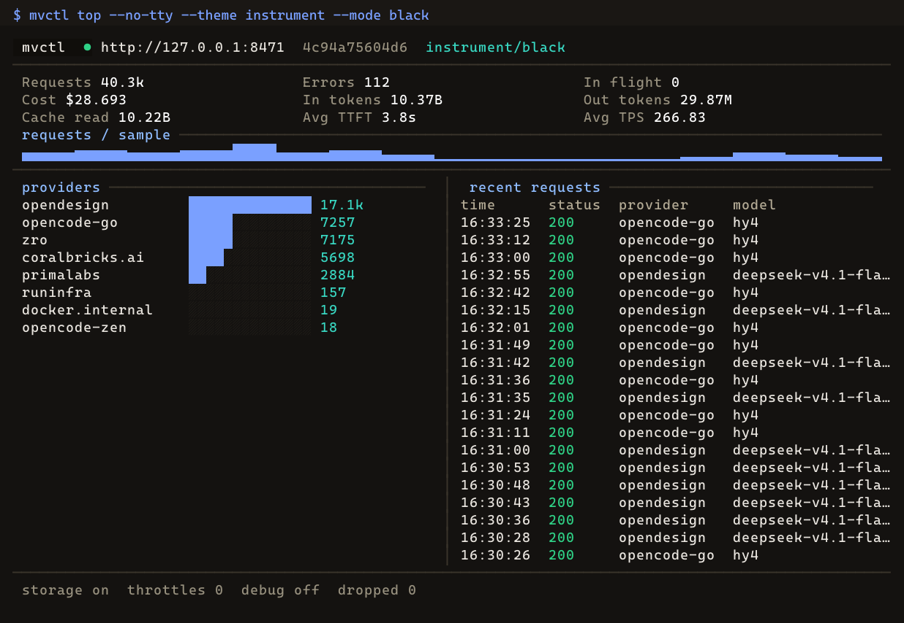
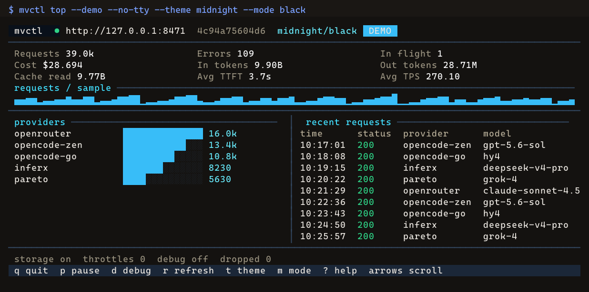
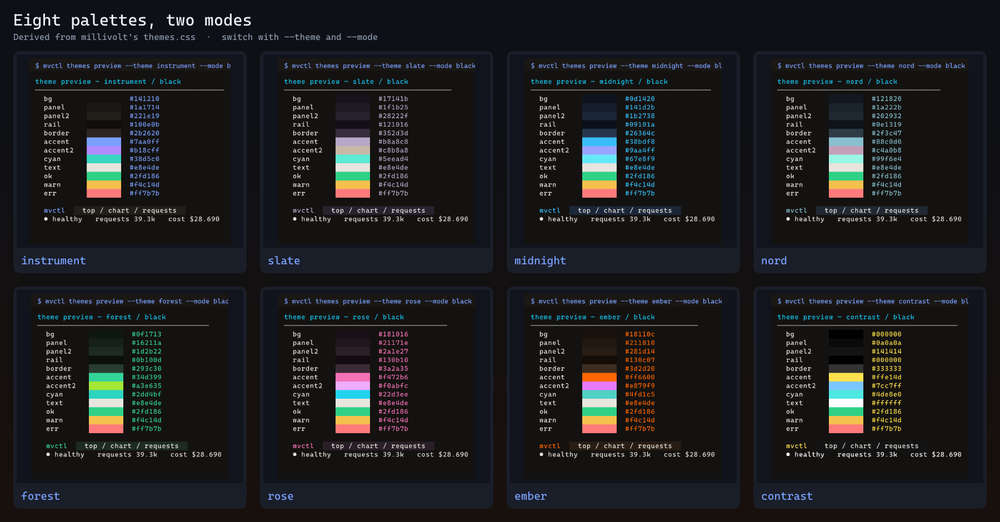

<p align="center">
  
</p>

<p align="center">
  <a href="https://github.com/hv-V6/millivolt-cli/releases"></a>
  <a href="https://github.com/hv-V6/millivolt-cli/blob/main/LICENSE"></a>
  <a href="https://go.dev/"></a>
  <a href="https://github.com/hv-V6/millivolt-cli/actions"></a>
  <a href="https://github.com/LLM-4-People/millivolt/pull/66"></a>
  <a href="screenshots/index.md"></a>
</p>

<p align="center">
  <b>One binary. Zero dependencies. Every millivolt control, view and dashboard in your terminal.</b>
</p>

<p align="center">
  <a href="#install">Install</a> ·
  <a href="#quickstart">Quickstart</a> ·
  <a href="#see-it-in-action">Screenshots</a> ·
  <a href="#themes">Themes</a> ·
  <a href="#commands">Commands</a> ·
  <a href="#safety">Safety</a> ·
  <a href="#upstream">Upstream PR</a>
</p>

---

## Why mvctl

<table>
<tr>
<td width="33%" valign="top">

**🎛️ Control**

Drive the whole operator plane: config, pause holds, provider throttles, quota
gates, queue draining, debug capture, purge, backup/restore and graceful
restart. `config set` uses the server's `revision` for optimistic concurrency.

</td>
<td width="33%" valign="top">

**📊 Observe**

KPIs, retained request log, bounded SQL, ASCII charts, spend attribution,
model/provider leaderboards, Prometheus exposition and an 8-point diagnostic.
Everything has a `--json` mode for scripts.

</td>
<td width="33%" valign="top">

**✨ Show off**

A live full-screen TUI with millivolt's own 8 palettes in 2 modes, a traffic
generator, a load benchmark, a scripted tour and a token-free dashboard proxy.

</td>
</tr>
</table>

> Auto-discovery means `mvctl status` just works: it finds a running millivolt
> from Docker Compose labels, a loopback `/healthz` probe and a bounded
> compose-file scan, then reads the operator credential from the deployment's
> own `.env`.

---

## Install

<table>
<tr><th width="33%">Prebuilt binary</th><th width="33%">From source</th><th width="33%">Self-install</th></tr>
<tr valign="top"><td>

Download the archive for your platform from
[Releases](https://github.com/hv-V6/millivolt-cli/releases) and put `mvctl` on
your `PATH`.

Windows · Linux (amd64/arm64) · macOS (amd64/arm64)

</td><td>

```sh
git clone https://github.com/hv-V6/millivolt-cli.git
cd millivolt-cli
go build -o mvctl ./cmd/mvctl
```

Requires Go 1.27.2+.

</td><td>

```sh
mvctl install          # preview
mvctl install --yes    # copies itself to ~/.local/bin
mvctl uninstall --yes
```

Pure Go: no shim, no `.cmd`, no package manager.

</td></tr>
</table>

---

## Quickstart

```sh
mvctl status                    # auto-discovers the running proxy
mvctl overview                  # full KPI / storage / operator state
mvctl requests 20               # recent proxied requests
mvctl top                       # live full-screen dashboard
```

Point it anywhere when needed:

```sh
mvctl --url http://127.0.0.1:8471 status
export MILLIVOLT_OPERATOR_TOKEN=...     # or --token / a profile / deployment .env
mvctl --json status | jq '.kpi.cost'
```

Everything supports `--json`, honours `--no-color` / `NO_COLOR`, and accepts
`--` to end flag parsing.

---

## See it in action

<p align="center">
  
</p>

<p align="center"><sub>Real ANSI output rendered as PNG by the pure-Go tool in <code>tools/screenshots</code>. <a href="screenshots/index.md">All 74 screenshots →</a></sub></p>

The live dashboard against real proxy data, and the synthetic demo feed:

<table>
<tr>
<td width="50%" align="center">
<br>
<sub><code>mvctl top --no-tty --theme instrument --mode black</code></sub>
</td>
<td width="50%" align="center">
<br>
<sub><code>mvctl top --demo --no-tty --theme midnight --mode black</code></sub>
</td>
</tr>
</table>

`top --demo` writes **nothing** to millivolt, so it is safe for screenshots,
GIFs and recordings. When stdout is not a TTY, `top` prints one static frame
instead of entering the alternate screen.

---

## Themes

<p align="center">
  
</p>

`top` ships millivolt's own palette registry as its baseline, derived from
`internal/web/static/css/themes.css` and `static/js/theme.js`. Every surface,
accent, ink and semantic status token is applied to the header, KPI tiles,
sparkline, provider bars, request table and badges.

| id | hint | id | hint |
| --- | --- | --- | --- |
| `instrument` *(default)* | Warm graphite, blue and violet | `forest` | Moss, emerald and lime |
| `slate` | Cool stone, lilac and sand | `rose` | Plum, pink and lilac |
| `midnight` | Deep navy, sky and periwinkle | `ember` | Charcoal, orange and orchid |
| `nord` | Arctic slate, frost and heather | `contrast` | Maximum separation |

Each palette has a `black` and a `clear` mode:

```sh
mvctl themes list
mvctl themes preview --theme nord --mode clear
mvctl top --theme midnight --mode black      # t cycles themes, m cycles modes
mvctl --theme rose --mode clear top --demo
```

---

## Commands

<details>
<summary><b>Full command reference</b> — click to expand</summary>

| Group | Commands |
| --- | --- |
| **View** | `status`, `overview`, `requests [N]`, `query "SELECT ..."`, `prometheus`, `watch`, `url`, `health`, `chart`, `explore`, `cost`, `models`, `providers`, `trace <id>` |
| **Control** | `config get\|set\|reload\|keys\|diff`, `pause [on\|off]`, `throttle set\|clear`, `quota [resume]`, `drain`, `debug [on\|off]`, `purge`, `backup`, `restore`, `restart` |
| **Manage** | `discover`, `setup`, `adopt`, `start`, `stop`, `up`, `update`, `repair`, `revert`, `resume`, `logs`, `doctor`, `images`, `serve`, `profiles`, `wait`, `install`, `uninstall` |
| **Show** | `top`, `themes list\|preview`, `demo`, `bench`, `chat`, `tour`, `dashboard` |

Global flags: `--json`, `--no-color` / `--color`, `--yes`, `--url`, `--token`,
`--timeout`, `--profile`, `--theme`, `--mode`, `--dir`, `--port`, `--verbose`,
`--version`, `--help`. `--flag=false` (or `=0`, `=no`, `=off`) disables a
boolean flag; `--` ends flag parsing.

```sh
mvctl chart --metric cost
mvctl explore --by provider --limit 8
mvctl cost --by model
mvctl doctor                                  # 8-point read-only diagnostic
mvctl config keys listen
mvctl config set history_size=10000 --yes
mvctl pause on --yes
mvctl throttle set --provider openrouter --concurrency 8 --yes
mvctl purge --client mvctl-demo --yes
mvctl backup --out backup.mvb
mvctl restore --file backup.mvb              # inspect only; --yes to apply
mvctl demo --yes && mvctl bench --yes
mvctl tour --no-delay
```

### Showcase commands

| Command | What it does |
| --- | --- |
| `mvctl top` | Live dashboard: KPI tiles, sparkline, provider bars, coloured request log, keybindings (`q`, `p`, `d`, `r`, `t`, `m`, `?`) |
| `mvctl demo --yes` | In-process OpenAI-compatible mock upstream + labelled traffic through millivolt |
| `mvctl bench --yes` | Concurrent load test with p50/p95/p99 latency |
| `mvctl chat "hello" --upstream URL --yes` | One-shot request with the correct `X-Proxy-*` headers |
| `mvctl tour` | Scripted status → overview → requests → chart → explore walkthrough |
| `mvctl dashboard` | Loopback proxy that injects the credential and strips frame headers, then opens the browser |

</details>

---

## Safety

- **Every state-changing command requires `--yes`**; without it, it prints a
  preview and performs no request.
- `purge` previews with `/admin/purge/count`; an unfiltered purge also needs
  `--all`.
- `--json` redacts credential-looking fields **inside typed structs and typed
  maps**; error bodies are scrubbed of the operator token; `discover` emits
  `has_token` only.
- `backup` refuses to overwrite without `--overwrite=true` and streams large
  archives to an `fsync`ed temp file — a truncated archive is an error, not a
  corrupt "success".
- `dashboard` uses a one-time URL secret exchanged for an `HttpOnly`,
  `SameSite=Strict` cookie; a `Host` header alone is not an auth boundary.
- Config/state writes are atomic, locked and `0600`; corrupt files are reported
  rather than silently reset.
- Docker is invoked with argv arrays (never a shell), bounded by timeouts,
  capped output and `WaitDelay`.

> On Windows, Unix permission bits are ignored by NTFS. `config.json`,
> `state.json` and a deployment `.env` can contain the operator token — keep
> the containing directory private to your user account.

---

## Multiple deployments

```sh
mvctl profiles add --name prod --url http://127.0.0.1:8471 --dir ~/millivolt --yes
mvctl profiles use --name prod --yes
mvctl --profile prod status
```

Precedence: **flags → environment → profile → state → deployment `.env` →
defaults**. Environment: `MILLIVOLT_URL`, `MILLIVOLT_OPERATOR_TOKEN`,
`MILLIVOLT_PORT`, `MVCTL_PORT`, `MVCTL_PROFILE`, `MVCTL_THEME`, `MVCTL_MODE`,
`NO_COLOR`, `MVCTL_NO_COLOR`.

---

## Architecture

```
cmd/mvctl/            CLI entry, command registry, shared operator core
  main.go             flags, dispatch, auto-discovery
  model.go            tolerant wire decoders
  client.go           Bearer-auth HTTP client (capped + streaming download)
  format.go           tables, sparklines, ANSI, credential redaction
  core.go             view + control commands (shared with upstream PR)
  extra.go            chart / explore / cost / models / providers / trace
  lifecycle.go        Docker deployment lifecycle
  showcase.go         TUI, demo, bench, chat, tour, dashboard
  install.go          self-install / uninstall
internal/
  config/             config, state, profiles, locked atomic writes
  docker/             argv-only Docker client, bounded output
  provision/          discovery, install, update, rollback, repair
  themes/             8 millivolt palettes x 2 modes
  tui/                ANSI renderer, dashboard, raw terminal (build-tagged)
  demo/               mock upstream and traffic generator
assets/               README presentation images (Go-generated)
screenshots/          74 PNG command verifications + index
tools/screenshots/    Go-only PNG screenshot + asset generator
```

The five files `model.go`, `client.go`, `format.go`, `core.go`, `core_test.go`
are copied **verbatim** into the upstream contribution.

---

## Development

```sh
go test ./...            # unit + in-process HTTP smoke tests
go test -race ./...      # race detector
go vet ./...
gofmt -l cmd internal
```

No test needs a live Docker daemon or network access. Regenerate the
verification screenshots and README art with:

```sh
cd tools/screenshots && go run . \
  -out ../../screenshots -assets ../../assets -assets-only
```

---

## Upstream

A deliberately small subset of this tool is proposed upstream as
**[LLM-4-People/millivolt#66](https://github.com/LLM-4-People/millivolt/pull/66)**:
`cmd/mvctl` plus `docs/cli.md`, HTTP-only, standard library only, no Docker, no
TUI. It is a human counterpart to the 22 MCP tools over the same
`/admin/*` and `/metrics/*` operator plane — no new endpoints, no new
dependencies, no runtime changes.

## Related

- [millivolt](https://github.com/LLM-4-People/millivolt) — the inference proxy
- [bb-plugin-millivolt](https://github.com/hv-V6/bb-plugin-millivolt) — the bb
  sidebar plugin whose provisioning logic this tool ports to Go
- [Changelog](CHANGELOG.md) · [Agent skill](SKILL.md) · [Screenshots](screenshots/index.md)

## License

[MIT](LICENSE). Palette values derived from millivolt's MIT-licensed
`themes.css`.

---

<p align="center">
  <sub>Built with Go · No runtime dependencies · 8 themes · 74 verified commands</sub>
</p>
